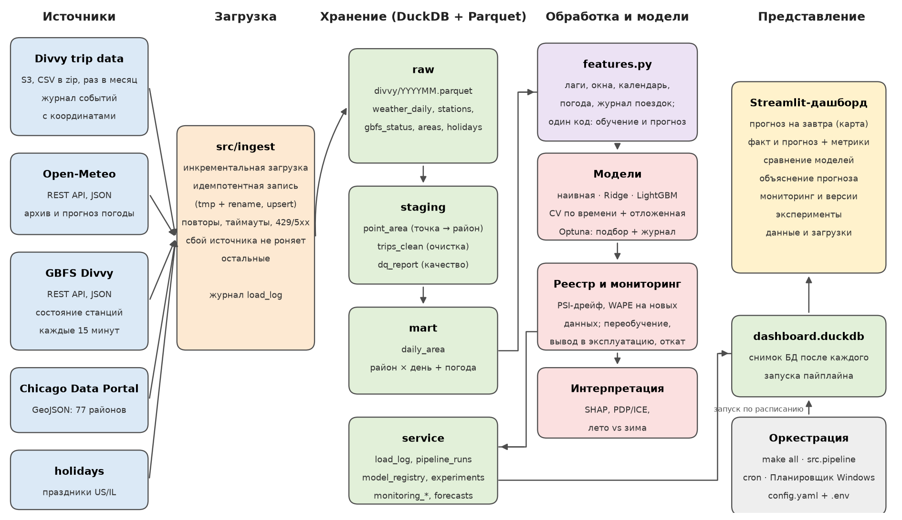

# Прогноз спроса на велопрокат по районам города

Проектная работа по дисциплине «Интеллектуальный анализ данных» (НИТУ МИСИС). Предметная область № 1 «Городская мобильность».

Прогнозно-аналитическая система полного цикла: загрузка открытых данных → хранилище и контроль качества → признаки → модели → объяснения → мониторинг и переобучение → дашборд. Всё запускается одной командой или по расписанию.

| | |
|---|---|
| **Прогнозируемый показатель** | число поездок велопроката Divvy (Чикаго) за сутки в каждом из 77 районов (community areas) |
| **Горизонт** | следующие сутки |
| **Пользователь** | диспетчер оператора велопроката |
| **Решения** | сколько велосипедов держать в районе, куда отправить грузовики перебалансировки, когда выводить парк на обслуживание |
| **Результат** | WAPE **12,7%** на отложенной выборке против 24,2% у наивного прогноза; суммарная ошибка по городу за день меньше на **46%** |

Отчёт: [report/Отчет_ИАД_городская_мобильность.pdf](report/Отчет_ИАД_городская_мобильность.pdf), презентация: [report/Презентация_ИАД_городская_мобильность.pdf](report/Презентация_ИАД_городская_мобильность.pdf).

## Быстрый старт

Нужен Python 3.11–3.13, около 2 ГБ свободного места и интернет. Путь к проекту лучше выбрать без кириллицы и пробелов.

**Windows (PowerShell):**
```powershell
py -3.12 -m venv .venv
.venv\Scripts\python -m pip install -r requirements.txt
copy .env.example .env
.venv\Scripts\python -m src.pipeline                        # полный цикл, первый раз 10–20 минут
# исследование (после первого полного цикла, когда данные уже загружены):
.venv\Scripts\python -m src.train
.venv\Scripts\python -m src.experiments search
.venv\Scripts\python -m src.monitor replay
.venv\Scripts\python -m src.pipeline                        # повторно: модель в эксплуатации — лучшая из подбора
.venv\Scripts\python -m streamlit run src\dashboard\app.py   # дашборд: http://localhost:8501
```

**Linux / macOS:**
```bash
make venv
make all          # загрузка → витрина → мониторинг → прогноз → объяснения → снимок для дашборда
make research     # сравнение моделей, автоподбор, демонстрация мониторинга на истории
make dashboard
make test
```

**По расписанию:** `scripts/crontab.example` (Linux/macOS) или `powershell -File scripts\schedule_windows.ps1` (Windows): пайплайн ежедневно в 06:00, снимки GBFS каждые 15 минут.

Все параметры задаются в `config.yaml`. Часть из них переопределяется переменными окружения или файлом `.env`, список — в `ENV_OVERRIDES` (`src/config.py`). На машине с малым объёмом памяти задайте `DUCKDB_MEMORY_LIMIT=500MB` и `DUCKDB_THREADS=1`.

## Команды

| Команда | Что делает |
|---|---|
| `python -m src.pipeline` (`make all`) | полный цикл эксплуатации; каждый запуск пишется в `pipeline_runs` |
| `python -m src.ingest all` | загрузка всех источников (инкрементально) |
| `python -m src.processing.build_mart` | очистка, проверки качества, витрина «район × день» |
| `python -m src.train` | сравнение трёх моделей: кросс-валидация по времени, отложенная выборка, важность и отбор признаков |
| `python -m src.experiments search` | автоматизированный подбор моделей и гиперпараметров (Optuna) с журналом |
| `python -m src.experiments reproduce <exp_id>` | воспроизвести эксперимент из журнала по идентификатору |
| `python -m src.monitor run` | мониторинг production-модели: качество, дрейф, переобучение, вывод, откат |
| `python -m src.monitor run --fault temperature` | реакция системы на смоделированный сбой входных данных |
| `python -m src.monitor replay` | демонстрация мониторинга на истории: без переобучения и с ним |
| `python -m src.monitor rollback` | ручной откат к предыдущей версии модели |
| `python -m src.production forecast` | прогноз на следующий день |
| `python -m src.production retrain` | ручное переобучение на лучшей конфигурации подбора и вывод в эксплуатацию |
| `python -m src.explain local --area 8 --date 2026-10-15` | объяснение прогноза для района и даты |
| `python -m src.explain global` | SHAP-важность, лето против зимы, PDP/ICE |
| `python -m src.status` | сводка: загрузки, качество данных, модели |
| `python -m pytest -q tests` | тесты (12): загрузка, утечка, мониторинг, реестр, единый код признаков |

## Архитектура



Текстовая версия схемы (Mermaid) — [docs/architecture.md](docs/architecture.md).

| Слой | Где | Содержимое |
|---|---|---|
| raw | `data/raw/divvy/YYYYMM.parquet`; таблицы `weather_daily`, `stations`, `gbfs_status`, `areas`, `holidays` | данные источников без изменений |
| staging | `point_area`, `trips_clean`, `dq_report` | привязка к районам, очищенные поездки, проверки качества |
| mart | `daily_area` | район × день: поездки, их структура, погода, праздники |
| service | `load_log`, `pipeline_runs`, `experiments`, `model_registry`, `monitoring_*`, `forecasts`, `explain_*` | журналы, реестр моделей, мониторинг, прогнозы, объяснения |

Дашборд читает снимок базы `data/dashboard.duckdb`, который пайплайн обновляет после каждого запуска.

## Источники данных

| Источник | Получение | Формат | Обновление | Тип |
|---|---|---|---|---|
| [Divvy trip data](https://divvy-tripdata.s3.amazonaws.com/index.html) | архивы на S3 | CSV в zip | ежемесячно | **журнал событий с координатами** |
| [Open-Meteo](https://open-meteo.com/en/docs) | REST API | JSON | ежедневно | архив и прогноз погоды |
| [GBFS Divvy](https://gbfs.divvybikes.com/gbfs/gbfs.json) | REST API | JSON | каждые 15 минут | **показания станций, геоданные** |
| [Chicago Data Portal](https://data.cityofchicago.org/d/igwz-8jzy) | Socrata API | GeoJSON | однократно | **полигоны районов** |
| holidays | библиотека Python | — | — | праздники US/IL |

Все данные открытые, персональных данных нет. Российские города рассматривались, но открытых данных о поездках нет ни у одного (на data.mos.ru поездок «Велобайка» нет, API закрыт), подробнее — в разделе 2 отчёта.

## Стек

| Компонент | Выбор | Почему |
|---|---|---|
| Хранилище | DuckDB + Parquet | аналитическая СУБД в одном файле без сервера; десятки миллионов строк на ноутбуке |
| Обработка | pandas, SQL, shapely | векторные операции, пространственное соединение точек с полигонами |
| Модели | scikit-learn, LightGBM | базовая, линейная модель и бустинг с категориями и встроенным TreeSHAP |
| Подбор | Optuna (TPE) | байесовский подбор с фиксированным зерном |
| Мониторинг | собственный модуль (PSI + тест Колмогорова–Смирнова) | прозрачные правила, результаты в той же базе |
| Дашборд | Streamlit + Plotly | интерактивный интерфейс на Python, карты районов, фильтры |
| Оркестрация | Makefile, cron, Планировщик Windows | одна команда и расписание |
| Конфигурация | `config.yaml` + `.env` | все параметры вне кода |

## Как выполнены требования

| Требование | Реализация |
|---|---|
| ≥ 2 разнородных источника, один слабоструктурированный | 5 источников: файлы, REST API, библиотека; CSV, JSON, GeoJSON; журнал поездок, геоданные, GBFS |
| Инкрементальность | качаются только новые месяцы и даты (по журналу); в ноябре загрузился только октябрь |
| Идемпотентность | tmp-файл + атомарное переименование, upsert по ключу, пересборка витрины |
| Устойчивость к сбоям | таймауты, повторы с паузой, 429 и `Retry-After`, 5xx; сбой одного источника не роняет остальные |
| Журнал загрузок | `load_log`, `pipeline_runs` |
| Очистка, пропуски, аномалии, контроль качества | правила очистки, сетка «район × день», 7 проверок с порогами (`dq_report`) |
| Признаки | 31 признак: лаги, окна, журнал поездок, календарь, погода, район |
| Единый код для обучения и прогноза | `build_features` + тест совпадения признаков (`tests/test_monitoring.py`) |
| Кодирование категориальных | one-hot для Ridge, нативные категории для LightGBM (обоснование — `src/models.py`, отчёт 4.3) |
| Отбор признаков | ablation по группам, 3 способа важности, состав групп подбирается автоматически |
| Утечка целевой переменной | `tests/test_no_leakage.py`: искажение будущего не меняет признаки прошлого; «лаг 0» тест ловит |
| Разбиение по времени, seed | 5 окон CV с расширяющимся обучением + отложенная выборка, seed 42, хеш версии данных |
| ≥ 3 моделей разных классов | наивная (неделю назад), Ridge, LightGBM |
| ≥ 2 метрики + понятная величина | WAPE, MAE, RMSE; поездки в день и % к базовому решению |
| Дашборд | 7 разделов, вопрос пользователя в заголовке каждого блока, фильтры, факт + прогноз + качество, автообновление |
| Интерпретируемость | важность тремя способами, SHAP-объяснение прогноза, PDP/ICE, лето против зимы |
| Мониторинг и переобучение | дрейф (PSI + KS), WAPE на новых данных, 4 правила, реестр версий, champion/challenger, откат |
| Подбор и журнал экспериментов | Optuna, журнал с конфигурацией, хешем данных и метриками; сравнение в дашборде; отложенная выборка; `reproduce` |

## Результаты

| Модель | WAPE, CV | WAPE, отложенная | MAE, отложенная |
|---|---|---|---|
| Наивный (значение неделю назад) | 34,1% ± 13,8% | 24,2% | 82,1 |
| Ridge | 19,3% ± 5,2% | 16,2% | 54,9 |
| LightGBM (config.yaml) | 14,8% ± 2,9% | 13,1% | 44,6 |
| **LightGBM после автоподбора** | **14,6%** | **12,7%** | **43,0** |

- **Подбор:** 25 экспериментов; лучший `S20261111-164522-018` (Tweedie, 1000 деревьев); воспроизводится по ID до 6-го знака.
- **Мониторинг на истории** (04.2025–10.2026): средний WAPE 14,5% без переобучения и 13,9% с мониторингом, 12 переобучений. Мониторинг нашёл реальную неоднородность источника: ветер в архиве Open-Meteo за 2024 год в среднем на ~35% выше, чем за 2025–2026 (вероятно, смена модели реанализа).
- **Октябрь 2026** (реальные новые данные): v1 ошибается на 11,8% при 12,0% на валидации, дрейфа нет, решение — «модель в норме».
- **Сценарий сбоя метеостанции:** сработало правило «аномалия входных данных» (PSI 8,2), тревога, реестр не меняется.


## Структура репозитория

```
config.yaml, .env.example      конфигурация
src/ingest/                    загрузчики источников + журнал загрузок
src/processing/                геопривязка, очистка, контроль качества, витрина
src/features.py                признаки (единый код для обучения и прогноза)
src/models.py, src/train.py    модели, кросс-валидация по времени, важность и отбор признаков
src/experiments.py             автоподбор (Optuna) и журнал экспериментов
src/production.py              обучение версий, прогноз на следующий день
src/registry.py, src/monitor.py  реестр версий, мониторинг, переобучение, откат
src/explain.py                 SHAP, PDP/ICE, важность по периодам
src/pipeline.py                полный цикл одной командой
src/dashboard/app.py           дашборд Streamlit
scripts/                       запуск по расписанию (cron, Windows)
notebooks/                     разведочный анализ и сравнение моделей
report/                        отчёт, презентация, скрипты их сборки
tests/                         тесты
```

## Ограничения

- публичные поездки публикуются раз в месяц, поэтому ежедневный прогноз «на завтра» в эксплуатации имитируется;
- при обучении используется фактическая погода, в эксплуатации — прогноз погоды;
- у 20% поездок (электровелосипеды без станции) координаты округлены до ≈1 км;
- GBFS не хранит историю, поэтому снимки пока служат для оперативной картины на дашборде.
