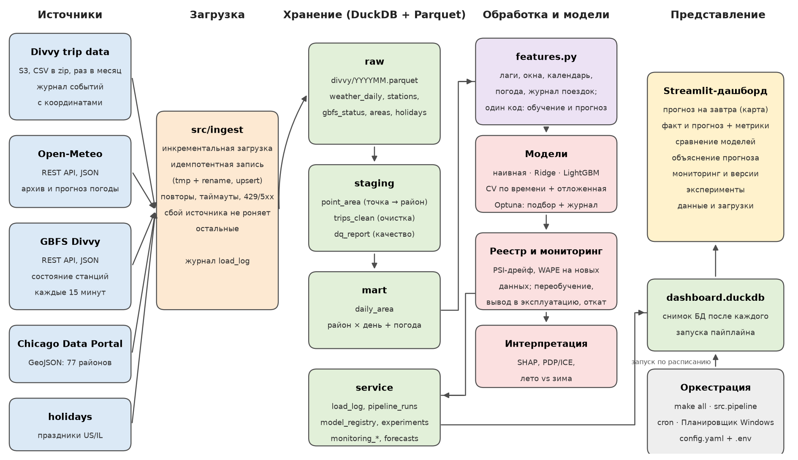
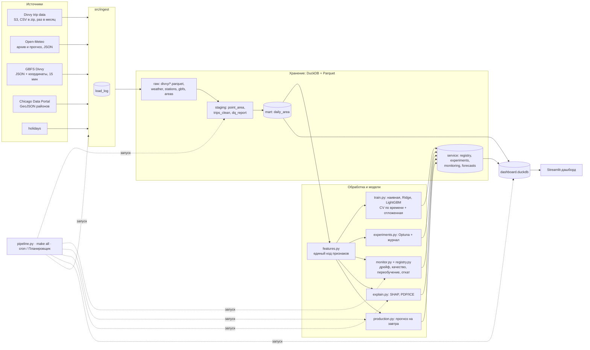

# Архитектура системы

| Слой | Где | Содержимое |
|---|---|---|
| raw | `data/raw/divvy/YYYYMM.parquet`, таблицы DuckDB | данные источников без изменений (только приведение типов) |
| staging | `point_area`, `trips_clean`, `dq_report` | привязка к районам, очищенные поездки, проверки качества |
| mart | `daily_area` | район × день: поездки, их структура, погода, праздники |
| service | `load_log`, `pipeline_runs`, `model_runs`, `experiments`, `model_registry`, `registry_events`, `monitoring_runs`, `monitoring_drift`, `monitoring_replay`, `live_predictions`, `forecasts`, `explain_*` | журналы, реестр моделей, мониторинг, прогнозы, объяснения |

Поток эксплуатации (`python -m src.pipeline`): загрузка → витрина и проверки качества → мониторинг production-модели (при срабатывании правил — претендент, вывод в эксплуатацию или отказ, откат) → прогноз на следующий день → объяснения → снимок базы для дашборда.

Исследовательский поток (`make research`): сравнение моделей → автоподбор с журналом → прогон мониторинга по истории.
